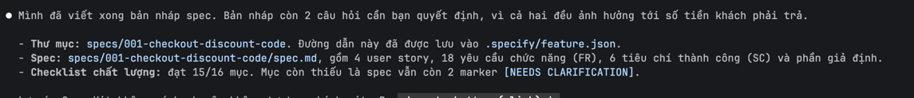

# 2.2 - Định nghĩa tính năng và viết spec

**Thời lượng:** 30 phút · **Kết quả:** `specs/001-<tên>/spec.md` không còn câu hỏi mở.

Tính năng của module này: **Mã giảm giá (coupon) ở trang thanh toán.**

## Bước 1 - Đọc feature brief (3')

Mở [reference/feature-brief-coupon.md](reference/feature-brief-coupon.md). Đây là đề bài từ phía nghiệp vụ:
chỉ có _cái gì_ và _tại sao_. Trước khi chạy lệnh, tự trả lời: bạn thấy chỗ nào **chưa rõ**?
Ghi ra 3 câu hỏi - lát nữa so sánh với câu hỏi của agent.

## Bước 2 - `/speckit-specify` (10')

Gõ `/speckit-specify` + dấu cách, rồi dán toàn bộ khối **Nội dung để dán vào /speckit-specify** của brief.

Agent sẽ:

1. Đặt tên ngắn cho tính năng và tạo thư mục `specs/001-<ten-ngan>/` (ví dụ `specs/001-coupon-code/`).
2. Viết `spec.md` theo template: User Stories (P1/P2/P3) kèm kịch bản Given/When/Then, Edge Cases,
   Functional Requirements (`FR-001`...), Key Entities, Success Criteria đo được, Assumptions.
3. Đánh dấu tối đa 3 điểm `[NEEDS CLARIFICATION]` và hỏi bạn dạng bảng lựa chọn A/B/C.
4. Tạo `checklists/requirements.md` để tự đánh giá chất lượng spec.

Trả lời các câu hỏi agent đưa ra (chọn đáp án hoặc tự gõ).

> 💡 Spec Kit mặc định **không** tạo nhánh git (đó là extension `git` tùy chọn). Thư mục feature đang
> hoạt động được ghi trong `.specify/feature.json`.

## Bước 3 - Review spec (7')

Mở `spec.md` và kiểm tra theo checklist:

- [ ] Không có chi tiết kỹ thuật (tên file, framework, API) - spec chỉ nói _hành vi_.
- [ ] Mỗi user story **kiểm thử độc lập** được, có kịch bản Given/When/Then.
- [ ] Có đủ 3 mã ví dụ (SHOPLITE10, GIAM50K, TET2026) trong kịch bản/acceptance.
- [ ] Requirement dùng ngôn ngữ đo được (MUST, con số cụ thể), không có từ mơ hồ như "nhanh", "thân thiện".
- [ ] Có yêu cầu chống gian lận (hệ thống tính lại giảm giá khi đặt hàng).
- [ ] Phần Ngoài phạm vi / Assumptions khớp với brief.

Ví dụ một kịch bản tốt:

```text
Given giỏ hàng có tạm tính 1.290.000đ
When khách nhập mã "SHOPLITE10" và bấm Áp dụng
Then tóm tắt đơn hiển thị dòng "Giảm giá: -100.000đ" (10% = 129.000đ nhưng tối đa 100.000đ)
And tổng thanh toán là 1.190.000đ
```

## Bước 4 - `/speckit-clarify` (8')

```text
/speckit-clarify
```

Agent quét spec theo nhiều nhóm (phạm vi, dữ liệu, edge case, bảo mật...) và hỏi **từng câu một**
(tối đa 5), mỗi câu kèm một đáp án _Recommended_. Câu trả lời được ghi vào `spec.md` ở mục
`## Clarifications`.

Câu hỏi thường gặp với tính năng này: mã có phân biệt hoa thường không? Ngưỡng miễn phí giao hàng tính
trước hay sau giảm giá? Giảm giá có trừ vào phí ship không? Mã còn giữ khi tải lại trang?

So sánh với 3 câu hỏi bạn tự ghi ở Bước 1. Agent có bỏ sót câu nào của bạn không? Nếu có, yêu cầu tiếp:

```text
/speckit-clarify Tập trung vào: điều gì xảy ra nếu mã hợp lệ lúc áp dụng nhưng hết hạn lúc bấm đặt hàng,
và nếu khách xóa bớt sản phẩm làm đơn không còn đạt giá trị tối thiểu.
```

## Bước 5 - Commit (2')

```bash
git add specs .specify
git commit -m "docs(spec): coupon code feature specification"
```

✅ **Checkpoint:** `grep -n "NEEDS CLARIFICATION" specs/*/spec.md` không còn kết quả; có mục
`## Clarifications` với ít nhất 3 câu trả lời.

## Lỗi thường gặp

- ⚠️ Viết brief kèm cách làm ("thêm bảng coupons, gọi API /validate"...) → spec bị trộn kỹ thuật,
  mất ý nghĩa của bước plan.
- ⚠️ Gõ `/speckit.specify` (dấu chấm) → không tồn tại trong Spec Kit 1.x.
- ⚠️ Chấp nhận mọi đáp án _Recommended_ mà không đọc → spec phản ánh ý của agent, không phải của bạn.
